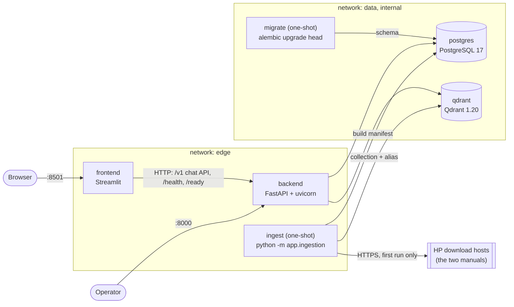
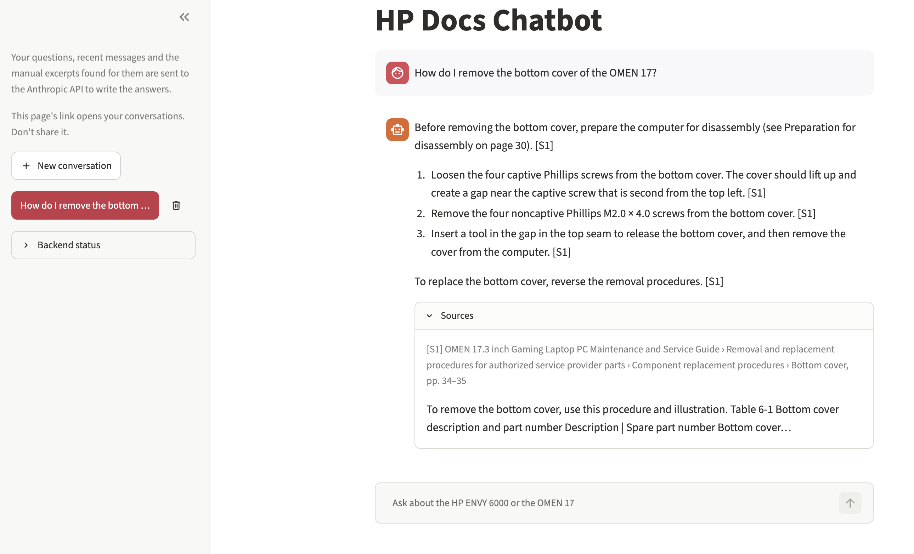
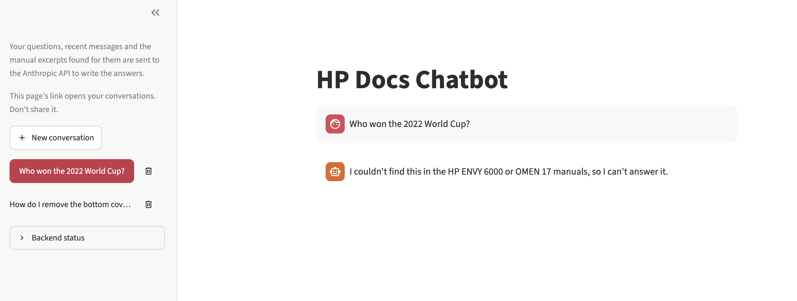
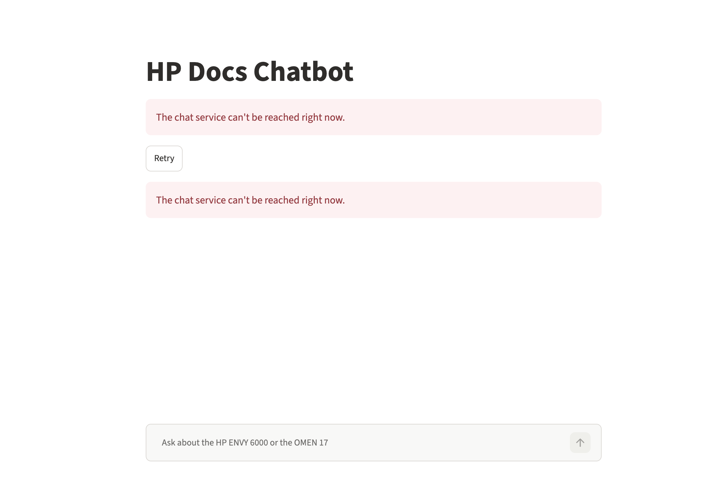

# HP Docs Chatbot

A chatbot that answers questions about two public HP documents using
Retrieval-Augmented Generation (RAG):

- HP ENVY 6000 All-in-One series User Guide
- OMEN 17.3 inch Gaming Laptop PC Maintenance and Service Guide

> **Status: Phase 4 (chat UI) built.** `docker compose up` downloads the two
> manuals, verifies them against pinned checksums and builds a hybrid (dense + BM25)
> Qdrant index of them. The API answers questions over SSE with citations, keeps
> conversations in Postgres and refuses when the manuals do not hold the answer
> ([Chat](#chat)). The Streamlit page at http://localhost:8501 is the chat
> ([Chat UI](#chat-ui)); see [Status](#status).

## Architecture



Startup order ([ADR 0007](docs/adr/0007-startup-order.md)): `postgres` and `qdrant`
healthy → `migrate` → `ingest` → `backend` → `frontend`. The backend starts only after
both one-shot services have completed successfully.

- **frontend** talks to the backend only over HTTP, from the Streamlit server.
- **backend** is the only service on both networks. `GET /health` is liveness and
  never touches dependencies; `GET /ready` probes Postgres (`SELECT 1`) and Qdrant
  (`/readyz`) concurrently and returns `503` with a per-dependency status document
  when one is down.
- **migrate** applies the Alembic migrations once per `up`; the backend entrypoint
  never migrates.
- **ingest** builds the vector index when it is missing or stale (see
  [Ingestion](#ingestion)). It is the only service that reaches the internet, and only
  to download the manuals on its first run. The pinned models are downloaded once, by
  the image build, and read offline at runtime
  ([ADR 0008](docs/adr/0008-baked-models-and-inference.md)).
- **postgres** and **qdrant** sit on an internal network with no route out and are
  never published.

Layering inside the backend: `api` → `services` → `domain` ← `infra`. `domain`
holds pure types and interfaces (for example `DependencyProbe`); `infra` holds the
real adapters; unit tests use fakes of the domain interfaces. The decisions behind
this are recorded in [docs/adr](docs/adr).

## Quick start

Requirements: Docker with Compose v2.

```bash
cp .env.example .env        # then set POSTGRES_PASSWORD and ANTHROPIC_API_KEY in .env
docker compose up --build   # or: make up (waits until every service is healthy)
```

`.env.example` selects the Anthropic API (`LLM_PROVIDER=anthropic`); without
`ANTHROPIC_API_KEY` the backend stops at startup with a message naming both fixes: set
the key, or set `LLM_PROVIDER=stub` to run everything offline with the deterministic
stub model (answers built from the retrieved excerpts, no API calls).

- Chat UI: http://localhost:8501
- API: http://localhost:8000 (`/health`, `/ready`, `/docs`)

Compose refuses to start without `POSTGRES_PASSWORD`. Only the API and the frontend
are published, on `127.0.0.1` by default. On a remote VM set `BIND_ADDRESS=0.0.0.0`
in `.env` to reach them from outside, and restrict access with the VM's firewall.

**The first `up` needs network access and takes a minute or more:** the image build
downloads the pinned models from the Hugging Face hub (about 150 MB, verified file by
file; ADR 0008), and `ingest` downloads the two manuals from HP, then builds the index.
Measured on a fresh clone with empty volumes (Apple M2, Docker Desktop with 8 CPUs and
4 GB, November 2026): image build 38 s (`--no-cache`), first `docker compose up --wait`
70 s, of which ingestion (download, parse, embed, upsert) is about 47 s (Phase 1, before
the models moved into the image; the model step adds about 17 s to a build with an
empty model cache, and a forced rebuild of the index takes about 60 s). Later runs need
no network: the models are in the image, the verified PDFs stay in the `corpus-cache`
volume, and a second `up` took 21 s (1.6 s of it in `ingest`, which found the index
current and skipped the build). If a download or a checksum check fails, the image
build or `ingest` stops, and **the backend does not start**, by design: the API never
runs on a missing or unverified index or model. `docker compose logs ingest` shows the
one structured error line; fix the network and run `docker compose up` again.

## Ingestion

`ingest` runs `python -m app.ingestion --if-needed` on every `docker compose up`:

1. **Download and verify.** Only the two URLs in
   [`backend/corpus.toml`](backend/corpus.toml) are allowed. Each PDF must match its
   pinned SHA-256; a mismatch fails the build (the upstream file changed and needs a
   review). Verified files are kept in `CORPUS_DIR` and reused offline.
2. **Parse and clean** with pdfplumber: bookmarks give the section hierarchy, footers
   give the printed page numbers, ruled tables keep each row whole, and the table of
   contents, the index, navigation lists, footers and non-English text are dropped
   with per-rule counts ([ADR 0004](docs/adr/0004-pdf-parsing.md)).
3. **Chunk** by structure: one section, procedure or table per chunk, at most 450
   bge-small tokens including the "document > chapter > section" prefix; procedures
   split at step boundaries and tables at row boundaries with the header repeated;
   WARNING and CAUTION notes stay with their step and flag the chunk
   ([ADR 0005](docs/adr/0005-chunking-v1.md)). Every chunk carries its document,
   section path, PDF and printed page ranges and content type.
4. **Embed** each chunk twice, with a dense model and BM25 (see
   [Embedding models](#embedding-models)), on CPU.
5. **Publish** into a new versioned Qdrant collection, check that its point count
   equals the chunk count, then move the `hpdocs_chunks` alias to it. The previous
   collection is kept for rollback (`INDEX_KEEP_PREVIOUS`); older ones are deleted.
   Each build writes a manifest row to Postgres (`index_builds`): document hashes,
   chunking version, model revisions and file digests, chunk counts per document, drop
   statistics, status.

The current index holds 287 chunks: 149 from the ENVY 6000 user guide and 138 from the
OMEN 17.3 service guide (chunking version v2).

`--if-needed` skips the build (no download, no model load) only when the live build
matches the pinned document hashes, the chunking version, both models and their pins,
and the collection's point count equals the manifest's chunk count; any difference
rebuilds ([ADR 0007](docs/adr/0007-startup-order.md)). **`make ingest`** always builds
a new index and moves the alias (`docker compose build backend`, then `docker compose
run --rm ingest --force`; 47 s measured, with the same 287 point IDs in the new
collection); the API keeps serving the old collection until the swap. `make
inspect-chunks` writes every chunk to the git-ignored `ingest-review/chunks.md` for
local review.

### Embedding models

| Role | Model | Files from | License |
|---|---|---|---|
| Dense (384 dimensions) | `BAAI/bge-small-en-v1.5` | [`Qdrant/bge-small-en-v1.5-onnx-Q`](https://huggingface.co/Qdrant/bge-small-en-v1.5-onnx-Q), Qdrant's quantized ONNX build | MIT |
| Sparse (BM25, IDF in Qdrant) | `Qdrant/bm25` | [`Qdrant/bm25`](https://huggingface.co/Qdrant/bm25) | Apache-2.0 |

Both run locally on CPU through fastembed; no embedding API is called. Each model is
pinned in [`backend/models.toml`](backend/models.toml) to a hub revision and the
SHA-256 of every file it loads; every build checks the digests, and a model without a
pin is never downloaded or loaded ([ADR 0006](docs/adr/0006-embedding-model-files.md)).
`make model-pins` regenerates the pins for review. The dense vectors come from the
quantized ONNX build, not the original weights, so published bge-small benchmark
scores are not a direct baseline for this index.

## Retrieval

Each question is searched with both vectors and the two lists are fused, then a local
cross-encoder reranks the candidates. Defaults (every one an environment variable,
see [Configuration](#configuration)):

| Setting | Default |
|---|---|
| `RETRIEVAL_MODE` | `hybrid` (dense + BM25, fused with reciprocal rank fusion) |
| `RETRIEVAL_RRF_K` | 60 |
| `RETRIEVAL_RERANK_ENABLED` | on: `RETRIEVAL_RERANK_CANDIDATES` 20 down to `RETRIEVAL_TOP_K` 5 |
| `RERANKER_MODEL` | `Xenova/ms-marco-MiniLM-L-6-v2` (MiniLM-L6) |
| `RETRIEVAL_RELEVANCE_THRESHOLD` | -6.54 (top rerank score; calibrated for MiniLM-L6) |
| `RETRIEVAL_PRODUCT_FILTER_ENABLED` | off |
| `RETRIEVAL_DENSE_QUERY_PREFIX` | empty (no BGE instruction) |

The reranker runs locally on CPU, pinned in `models.toml` and baked into the image like
the embedding models (license note in [ADR 0008](docs/adr/0008-baked-models-and-inference.md)).

**Why these defaults:** on the 56 dev questions of the frozen golden set, every
configuration ties on Recall@5 by the selection rule (overlapping intervals), and
`hybrid-rerank` shares the top MRR (0.898) and comes first in matrix order within the
latency margin; the threshold refuses 2 of 48 in-scope questions and catches unrelated
ones, but not questions close to the manuals' domain. Full record:
[the benchmark summary](eval/reports/retrieval-summary.md) and
[ADR 0009](docs/adr/0009-retrieval-strategy-and-evaluation.md). `POST /v1/search` (off
by default, `SEARCH_ENDPOINT_ENABLED`) exposes retrieval for debugging; it is
rate-limited, and the backend logs a warning at startup when it is enabled with
`APP_ENV=production`. Chat answers are built on this retrieval ([Chat](#chat)).

**Rerun the benchmark** (dev split; details in [eval/README.md](eval/README.md)):

```bash
make up
make eval-retrieval EVAL_ARGS=preflight                   # resolve every golden anchor
make eval-retrieval EVAL_ARGS=run                         # every config in the matrix
make eval-retrieval EVAL_ARGS="run --config hybrid-rerank" # one config
```

The BM25 avg_len row is a separate index build, scored by its collection name
(`hpdocs_chunks_<chunking version>_<build id>`):

```bash
EMBEDDING_BM25_AVG_LEN=auto make ingest
make eval-retrieval EVAL_ARGS="run --config hybrid-rerank --collection <auto build>"
make ingest                                               # restore the default build
```

Compare runs only on the same index build: candidate lists are deterministic per
build, not across builds (ADR 0009).

## Chat

Conversations belong to an anonymous client ID sent as `X-Client-ID` (the chat UI
keeps one per browser). Endpoints, under `/v1` (full contract in
[ADR 0010](docs/adr/0010-chat-api.md)):

| Endpoint | What it does |
|---|---|
| `POST /conversations` | Create a conversation (201) |
| `GET /conversations?limit=20&cursor=` | The client's conversations, newest first, paged |
| `GET /conversations/{id}` | One conversation with its messages, citations and sources |
| `DELETE /conversations/{id}` | Delete it with its messages (204) |
| `POST /conversations/{id}/messages` | Ask; the answer streams as server-sent events |

Another client's conversation is 404. A question is 1 to 1,000 characters.

```bash
CID=demo-client-1
CONV=$(curl -s -X POST localhost:8000/v1/conversations -H "X-Client-ID: $CID" | jq -r .id)
curl -N -X POST "localhost:8000/v1/conversations/$CONV/messages" \
  -H "X-Client-ID: $CID" -H "Content-Type: application/json" \
  -d '{"content": "How do I remove the bottom cover of the OMEN laptop?"}'
```

The stream is `token` events, then `sources` (document, section, printed and PDF
pages, a snippet for each cited excerpt) and `done` (the validated answer, citations,
outcome). A failure after the first token ends it with an `error` event; a failure
before it is a plain JSON error (502/503) and nothing is stored.

**How an answer is made.** From the second turn on, the question is rewritten into a
standalone search query by a small model (`LLM_REWRITE_MODEL`), falling back to the
raw question on any problem. Retrieval runs as in [Retrieval](#retrieval). If the top
rerank score is below the threshold, the assistant refuses without calling the answer
model. Otherwise the answer model (`LLM_ANSWER_MODEL`) answers from the five excerpts
only, citing them as `[S1]`, `[S2]` ..., and replies with a marker when they do not
hold the answer, which becomes the same fixed refusal. Citations to excerpts that were
not retrieved are removed. The prompt asks the model to carry the WARNING and CAUTION
notes that apply into the answer. Each stored answer records the chunk IDs, index build, served model, tokens
and timings.

**Stub model.** `LLM_PROVIDER=stub` answers deterministically from the excerpts, for
tests, demos and the Phase 6 load tests. Outside production, `[stub:refuse]`,
`[stub:fail-before]` and `[stub:fail-after]` in a question make it refuse or fail on
purpose. `make smoke-llm` (manual, billed, needs the key) sends a few synthetic
requests to the real models and prints the time to first token, the stop reasons and
whether the follow-up rewrite worked; never the model's text.

**Rate limits** (per `X-Client-ID`): 10 questions a minute with a burst of 5, 120
conversation reads and writes a minute with a burst of 30; over the limit is 429 with
`Retry-After`. The limits are kept in memory **per backend replica**, so N replicas
allow N times the rate.

**Retention.** A conversation is deleted with its messages `CHAT_RETENTION_DAYS` (30)
after its last message. The backend purges at startup and every
`RETENTION_PURGE_INTERVAL_MINUTES` (60; 0 turns it off), one replica at a time under a
Postgres advisory lock; `make purge` runs one purge now and prints the counts. Logs
carry counts only.

## Chat UI

The Streamlit page at http://localhost:8501 talks to the API only over HTTP
([ADR 0011](docs/adr/0011-chat-ui.md)).

- **Conversations** are listed in the sidebar, newest first, with "New conversation",
  "Load more" and a delete button that asks for confirmation. A conversation is
  created with its first question.
- **Answers stream** token by token; while one streams, every widget is disabled. Each
  answer cites its excerpts as `[S1]`, `[S2]` ..., and the latest answer opens its
  Sources: document, section, printed and PDF pages, a snippet, and a WARNING/CAUTION
  badge when the excerpt carries such a note.
- **Refusals and errors** use fixed wording. A failure before the first token keeps the
  question in a copyable box, and nothing is stored. A failure after it keeps the
  partial answer, marked incomplete. An uncited answer is kept and labelled.
- **Your link is your identity.** The page keeps an anonymous client ID in the URL
  (`cid`), and the open conversation in `conv`: reloading or bookmarking the link
  reopens your conversations, and anyone with the link can read them. The sidebar
  says so. A second browser without the link sees nothing.
- **Privacy notice.** The sidebar and the empty page say what leaves the machine: with
  `LLM_PROVIDER=anthropic`, your questions, recent messages and the excerpts found for
  them go to the Anthropic API; with the stub, nothing does.
- The page reaches the API at `BACKEND_URL`, which compose sets to
  `http://backend:8000`; it is wiring, not configuration, so it is not in
  `.env.example`.

### Screenshots

A cited answer with its sources open:



An out-of-scope question refused with the fixed wording:



The page reloaded while the backend is down, with the Retry button:



## Configuration

Everything is configured through environment variables (`.env` for Compose).
Compose-only keys: `BIND_ADDRESS`, `API_PORT`, `FRONTEND_PORT`. The frontend reads
`BACKEND_URL` (default `http://backend:8000`). Backend settings:

<!-- settings-table:start (generated by `make docs-config`) -->
| Variable | Default | Description |
|---|---|---|
| `APP_ENV` | `development` | `development`, `test` or `production`. |
| `LOG_LEVEL` | `INFO` | `DEBUG`, `INFO`, `WARNING`, `ERROR` or `CRITICAL`. |
| `LOG_INCLUDE_EXCEPTION_MESSAGES` | `false` | Log exception messages (they may contain user text). Local debugging only; rejected in production. |
| `CORS_ALLOWED_ORIGINS` | `http://localhost:8501` | Comma-separated browser origins allowed by CORS; `*` is rejected. |
| `API_DOCS_ENABLED` | `true` | Serve `/docs`, `/redoc` and `/openapi.json`. |
| `POSTGRES_HOST` | `postgres` | Postgres host (fixed in Compose). |
| `POSTGRES_PORT` | `5432` | Postgres port (fixed in Compose). |
| `POSTGRES_DB` | `hpdocs` | Database name. |
| `POSTGRES_USER` | `hpdocs` | Database user. |
| `POSTGRES_PASSWORD` | *required* | Database password. Required; never has a default. |
| `POSTGRES_POOL_SIZE` | `5` | Pooled connections kept per API process. |
| `POSTGRES_MAX_OVERFLOW` | `5` | Extra connections beyond the pool; the cap is pool size plus this. |
| `POSTGRES_CONNECT_TIMEOUT_SECONDS` | `5.0` | Timeout for opening a Postgres connection. |
| `QDRANT_URL` | `http://qdrant:6333/` | Qdrant REST base URL (fixed in Compose). |
| `QDRANT_COLLECTION_ALIAS` | `hpdocs_chunks` | Alias that always names the live chunk collection. |
| `INDEX_KEEP_PREVIOUS` | `true` | Keep the previous build's collection after a swap, for rollback; older builds are always deleted. |
| `READINESS_TIMEOUT_SECONDS` | `2.0` | Per-dependency timeout for `GET /ready`. |
| `CORPUS_DIR` | `corpus` | Cache directory for the verified source PDFs; reused offline. |
| `CORPUS_MAX_BYTES` | `33554432` | Largest accepted source PDF, in bytes. |
| `CORPUS_DOWNLOAD_TIMEOUT_SECONDS` | `120.0` | Per-phase HTTP timeout and total deadline for one PDF download. |
| `EMBEDDING_DENSE_MODEL` | `BAAI/bge-small-en-v1.5` | fastembed dense model; its tokenizer also measures chunk size. |
| `EMBEDDING_SPARSE_MODEL` | `Qdrant/bm25` | fastembed sparse model. |
| `EMBEDDING_CACHE_DIR` | `models` | Cache directory for the downloaded embedding models; reused offline. |
| `EMBEDDING_BATCH_SIZE` | `32` | Texts per embedding batch (bounds memory). |
| `EMBEDDING_BM25_AVG_LEN` | `256.0` | BM25 average document length for the stored sparse vectors, or `auto` for the mean of the chunks being built; recorded per build (ADR 0009). |
| `CHUNK_MAX_TOKENS` | `450` | Largest chunk in dense-model tokens, prefix included; bge-small reads at most 512 (ADR 0005). |
| `CHUNK_MIN_TOKENS` | `65` | Sections below this many tokens merge with the next one under the same parent (ADR 0005). |
| `RETRIEVAL_MODE` | `hybrid` | `dense`, `sparse` or `hybrid` (dense and BM25 fused with RRF). |
| `RETRIEVAL_RERANK_ENABLED` | `true` | Rerank the candidates with the cross-encoder. |
| `RETRIEVAL_TOP_K` | `5` | Chunks returned per question. |
| `RETRIEVAL_RERANK_CANDIDATES` | `20` | Candidates the reranker scores; at least `RETRIEVAL_TOP_K`. |
| `RETRIEVAL_PREFETCH_DENSE_LIMIT` | `20` | Dense candidates before fusion; at least `RETRIEVAL_RERANK_CANDIDATES`. |
| `RETRIEVAL_PREFETCH_SPARSE_LIMIT` | `20` | BM25 candidates before fusion; at least `RETRIEVAL_RERANK_CANDIDATES`. |
| `RETRIEVAL_RRF_K` | `60` | Reciprocal rank fusion constant k (Qdrant's default is 2). |
| `RETRIEVAL_PRODUCT_FILTER_ENABLED` | `false` | Restrict the search to one manual when the question names its product. |
| `RETRIEVAL_RELEVANCE_THRESHOLD` | `-6.54` | Lowest top reranker score that counts as relevant. Calibrated for Xenova/ms-marco-MiniLM-L-6-v2 @ a09144355ade on the dev split (ADR 0009): 2 of 48 in-scope questions refused, 4 of 4 unrelated and 0 of 4 near-domain out-of-scope questions caught. Fragile (8 out-of-scope questions); recalibrate when the reranker changes. |
| `RETRIEVAL_DENSE_QUERY_PREFIX` | *empty* | Text put before the question for the dense query only (BGE instruction). |
| `RERANKER_MODEL` | `Xenova/ms-marco-MiniLM-L-6-v2` | fastembed cross-encoder; must be pinned in `models.toml`. |
| `INFERENCE_WORKERS` | `2` | Threads that run embedding and reranking for requests. |
| `INFERENCE_ONNX_THREADS` | `2` | ONNX intra-op threads per model call; workers times threads should fit the container's CPUs. |
| `QDRANT_SEARCH_TIMEOUT_SECONDS` | `2.0` | Deadline for one Qdrant search. |
| `QUERY_MAX_CHARS` | `1000` | Longest accepted question, in characters. |
| `RATE_LIMIT_CONVERSATIONS_PER_MINUTE` | `120` | Conversation create, list, read and delete calls per client ID per minute. |
| `RATE_LIMIT_CONVERSATIONS_BURST` | `30` | Conversation calls a client may make at once (opening the UI loads several). |
| `RATE_LIMIT_SEARCH_PER_MINUTE` | `30` | `POST /v1/search` calls per client ID (else per IP) per minute. |
| `RATE_LIMIT_SEARCH_BURST` | `10` | Search calls allowed at once. |
| `RATE_LIMIT_MESSAGES_PER_MINUTE` | `10` | Chat questions per client ID per minute (each one may call the model). |
| `RATE_LIMIT_MESSAGES_BURST` | `5` | Chat questions a client may send at once. |
| `RATE_LIMIT_MAX_KEYS` | `10000` | Client IDs or IPs tracked per limiter and replica; the least recent is forgotten. |
| `LLM_PROVIDER` | `stub` | `stub` (deterministic, no network) or `anthropic` (needs the API key). |
| `ANTHROPIC_API_KEY` | *unset* | Anthropic API key; required with `LLM_PROVIDER=anthropic`, passed to the client explicitly so no ambient credential is used. |
| `LLM_REFUSAL_FALLBACK_ENABLED` | `true` | Let the API rerun a safety-refused answer on its fallback model (beta `server-side-fallback-2026-07-01`); the model that served is stored. |
| `LLM_CONNECT_TIMEOUT_SECONDS` | `5.0` | Deadline to connect to the model API. |
| `LLM_FIRST_TOKEN_TIMEOUT_SECONDS` | `30.0` | Deadline from the request to the first answer text (thinking included). |
| `LLM_MAX_RETRIES` | `2` | Client retries of 408, 409, 429, 5xx and connection errors, only before a stream opens. |
| `LLM_ANSWER_MODEL` | `claude-sonnet-5-5` | Model that writes the answers (Anthropic model ID). |
| `LLM_ANSWER_EFFORT` | `low` | Effort sent with each answer request: `low`, `medium`, `high`, `xhigh` or `max`; empty sends none. |
| `LLM_ANSWER_MAX_TOKENS` | `2048` | Output cap per answer, thinking included; a long cited procedure needs about 600. |
| `LLM_REWRITE_MODEL` | `claude-haiku-5-5` | Model that rewrites follow-ups into standalone search queries. |
| `LLM_REWRITE_EFFORT` | `low` | Effort sent with each rewrite request: `low`, `medium`, `high`, `xhigh` or `max`; empty sends none. |
| `LLM_REWRITE_MAX_TOKENS` | `100` | Output cap per rewrite; a query is at most 30 words. |
| `LLM_TOTAL_TIMEOUT_SECONDS` | `120.0` | Deadline for one whole answer. |
| `LLM_REWRITE_TIMEOUT_SECONDS` | `5.0` | Deadline for one rewrite; past it, retrieval uses the raw message. |
| `LLM_STUB_TOKEN_DELAY_MS` | `0` | Pause before each piece of a stub answer, to simulate streaming. |
| `CHAT_HISTORY_MAX_TURNS` | `6` | Earlier turns the answer prompt carries at most. |
| `CHAT_HISTORY_MAX_TOKENS` | `3000` | Estimated tokens of history the answer prompt carries at most. |
| `CHAT_REWRITE_HISTORY_TURNS` | `3` | Earlier turns the rewrite prompt sees at most; 0 disables rewriting. |
| `CHAT_REWRITE_HISTORY_TOKENS` | `1000` | Estimated tokens of history the rewrite prompt sees at most. |
| `CHAT_MESSAGE_MAX_CHARS` | `1000` | Longest accepted chat question, in characters (after trimming). |
| `SSE_HEARTBEAT_SECONDS` | `15.0` | Silence on an answer stream before a `: keepalive` comment is sent. |
| `CHAT_SNIPPET_CHARS` | `160` | Length of the excerpt shown on each source card. |
| `CHAT_RETENTION_DAYS` | `30` | Days after its last message before a conversation is deleted with its messages. |
| `RETENTION_PURGE_INTERVAL_MINUTES` | `60` | Minutes between the backend's retention purges; 0 turns the task off (`make purge` still works). |
| `SEARCH_ENDPOINT_ENABLED` | `false` | Serve the `POST /v1/search` debug endpoint (returns chunk text); a warning is logged when enabled in production. |
<!-- settings-table:end -->

A unit test fails if this table, `.env.example` and the `Settings` class disagree.

## Make targets

| Target | What it does |
|---|---|
| `make install` | Install the locked dependencies of both projects (used by CI) |
| `make setup` | `install` plus the pre-commit hooks (local development) |
| `make lint` / `make format` | ruff check and format, backend and frontend |
| `make typecheck` | mypy `--strict`, backend and frontend |
| `make test` | Unit tests with a branch-coverage gate of 90%, both projects |
| `make test-int` | Integration tests against real Postgres and Qdrant (Docker), plus the corpus and model tests on the real manuals and models |
| `make test-ui-int` | The real chat page against the running stub stack (local only; see [Development and testing](#development-and-testing)) |
| `make fetch-test-assets` | Download and verify the manuals and models for `test-int` (3 attempts; the CI download step) |
| `make security` | bandit, pip-audit on both lock files, gitleaks on the history |
| `make images` / `scan-images` / `scan-config` | Build images; Trivy image and Dockerfile scans |
| `make lint-workflows` | actionlint on the GitHub Actions workflow |
| `make up` / `make down` | Start (waiting for health) or stop the stack |
| `make docs-config` | Print the configuration table above |
| `make check` | lint + typecheck + test + security; run before every commit |
| `make ingest` | Build a new vector index now and move the alias (`up` builds only when needed) |
| `make inspect-chunks` | Write every chunk to `ingest-review/chunks.md` (git-ignored) for review |
| `make model-pins` | Regenerate `backend/models.toml` from the hub and print the diff (manual, review before committing) |
| `make smoke-llm` | Manual and billed: a few synthetic requests to the real Anthropic models; prints time to first token, stop reasons and the rewrite outcome (`SMOKE_ARGS="--runs N"`) |
| `make purge` | Delete conversations older than `CHAT_RETENTION_DAYS` now (needs `make up`); prints the counts |
| `make eval-retrieval` | Retrieval benchmark against the running stack (`EVAL_ARGS=preflight` or `run ...`; see [eval/README.md](eval/README.md)) |
| `make eval` / `load` | Later phases; print "not implemented yet" and fail |

## Repository layout

```
backend/            FastAPI app (uv project, own lock file)
  app/api/          routes and FastAPI dependencies
  app/core/         settings, JSON logging, request ID middleware, errors
  app/domain/       pure types and interfaces (no I/O)
  app/services/     orchestration (readiness, retrieval)
  app/infra/        adapters: Postgres, Qdrant, PDF parser, downloads, fastembed
  app/ingestion/    ingestion stages and CLI (python -m app.ingestion)
  app/evaluation/   retrieval benchmark: golden set, metrics, runner, CLI (python -m app.evaluation)
  alembic/          migrations 0001-0004 (baseline, index_builds, error_type, sparse_params)
  corpus.toml       the two allowed manuals with their pinned SHA-256
  models.toml       the pinned model revisions and file digests (embeddings, reranker)
  tests/unit/       no network, no containers; coverage gate
  tests/integration/  real Postgres and Qdrant
  tests/corpus/     the real manuals (marker `corpus`)
  tests/embeddings/ the real models (marker `model`)
frontend/           Streamlit app (uv project, own lock file)
eval/               golden set, retrieval matrix and benchmark reports (Phase 2), generation metrics (Phase 5)
loadtest/           placeholder for Phase 6
docs/adr/           architecture decision records
docker-compose.yml       full stack
docker-compose.test.yml  throwaway Postgres and Qdrant for integration tests
```

## Development and testing

Requirements: Python 3.12, [uv](https://docs.astral.sh/uv/), Docker.

```bash
make setup
make check       # what CI runs on every push, minus integration and images
make test-int    # starts docker-compose.test.yml on 127.0.0.1:55432/56333, tears down
```

`make test-int` also runs the corpus and model tests, which download the manuals and
the models on their first run (into `backend/corpus/` and `backend/models/`, both
git-ignored) and reuse them afterwards. A download problem fails as CORPUS UNAVAILABLE
or MODEL UNAVAILABLE, and a file that no longer matches its pin as CORPUS (or MODEL)
CHANGED UPSTREAM, never as a test assertion.

The project is built test-first. Unit tests use fakes that implement the domain
interfaces (for example `FakeProbe`), never real databases or the network; the
backend and the frontend each have a 90% branch-coverage gate (currently 100%).
Integration tests run Alembic and the probes against real containers and fail,
rather than skip, when those containers are not running.

**UI integration tests** (`make test-ui-int`, local only, not in CI yet) run the real
page and HTTP client against the running stack with the stub model. They fail when
the backend is down, and stop before sending anything unless `/ready` reports
`"llm": "stub"`. Your `.env` may not set `LLM_PROVIDER` (compose then defaults to the
stub, while a fresh copy of `.env.example` selects anthropic), so every recipe below
passes it explicitly:

```bash
# Stub stack (the closed-stream test needs a token delay above 0)
LLM_PROVIDER=stub LLM_STUB_TOKEN_DELAY_MS=50 docker compose up -d --build --wait
curl -s localhost:8000/ready | jq -c '{status, llm}'   # {"status":"ready","llm":"stub"}
make test-ui-int

# Switch the model without rebuilding (/ready is not_ready for ~10 s while models load)
LLM_PROVIDER=anthropic docker compose up -d --no-deps --no-build --wait backend

# Real-key stack
LLM_PROVIDER=anthropic docker compose up -d --build --wait
```

For a manual browser check, rebuild the frontend image first (`--build`) and use
`LLM_STUB_TOKEN_DELAY_MS=150` so the streaming is visible. `up` reruns `migrate` and
`ingest --if-needed` each time.

Run the pieces without Docker (needs the variables from `.env.example`):

```bash
cd backend && uv run uvicorn app.main:create_app --factory --no-server-header
cd frontend && BACKEND_URL=http://localhost:8000 uv run streamlit run app.py
```

CI (GitHub Actions) runs lint, typecheck, unit tests with a coverage summary,
integration, corpus and model tests, security scans and a Docker build with Trivy.
Every job calls the Makefile, so CI and local runs execute the same commands, and no
job needs a `.env`. The integration job downloads the manuals live from HP on every
run and verifies them against the pinned checksums; **no HP content is stored by
GitHub**: the PDFs are never cached or uploaded as artifacts, and corpus-test failures
print page numbers, counts and identifiers, never document text. Only the open-source
model files are kept in the Actions cache, keyed by `backend/models.toml`. Mark the
integration job as a required check in the branch protection settings.

## Security and data governance

- **Secrets** come only from environment variables. `.env` is git-ignored and
  `.env.example` holds placeholders. The database password is a `SecretStr`, the
  DSN is unwrapped in exactly one place, and neither appears in logs, images or
  `docker history`.
- **Logs** are one JSON object per line with a request ID. Request bodies and query
  strings are never logged; exception messages are left out of logs by default,
  because they can contain user text (`LOG_INCLUDE_EXCEPTION_MESSAGES` re-enables
  them locally and is rejected in production).
- **Errors** share one JSON shape and never include stack traces or internals;
  validation errors omit the submitted input.
- **Containers** run as non-root numeric users, with all capabilities dropped,
  `no-new-privileges` and a read-only root filesystem. Base images are pinned by
  digest and scanned with Trivy (vulnerabilities and secrets); dependencies are locked
  and audited with pip-audit; Dependabot proposes updates weekly. The secret scan has
  one exception ([trivy-secret.yaml](trivy-secret.yaml)): the GCP service-account rule
  skips the Anthropic SDK's package, whose docstrings contain the literal it matches.
- **Corpus**: the HP PDFs are copyrighted by HP and are not in this repository.
  Ingestion downloads them from their public URLs, accepts only those two, and verifies
  pinned checksums. Your copies stay in the local `corpus-cache` volume (and, for
  tests, the git-ignored `backend/corpus/`).
- **Telemetry**: usage telemetry is disabled in every container through each
  component's documented setting: onnxruntime (`ORT_DISABLE_TELEMETRY` and its
  `disable_telemetry_events()` call), the Hugging Face hub (`HF_HUB_DISABLE_TELEMETRY`),
  Qdrant (`QDRANT__TELEMETRY_DISABLED`) and Streamlit (`gatherUsageStats` off). This was
  set from the documentation, not verified by capturing traffic.
- **Outbound traffic**: at runtime, `ingest` downloads the two manuals from HP on its
  first run, and with `LLM_PROVIDER=anthropic` the backend calls the Anthropic API
  (`https://api.anthropic.com`, set in code; the key is passed explicitly, so no
  ambient credential or base URL is used). The pinned models come from the Hugging
  Face hub during the image build only. With `LLM_PROVIDER=stub` nothing leaves the
  stack after ingestion.
- **Third-party processing**: with `LLM_PROVIDER=anthropic`, **the user's question,
  recent conversation history (for the answer and for the follow-up rewrite) and the
  retrieved document excerpts are sent to the Anthropic API** to generate answers.
- **Chat data** is personal data: messages are never logged (logs carry IDs, counts,
  timings and codes; a unit test checks a canary string never reaches a log line),
  a conversation can be deleted at any time, and retention deletes conversations
  `CHAT_RETENTION_DAYS` after their last message. Every conversation and message query
  is scoped to the caller's `X-Client-ID`.

## Third-party licenses

The backend and frontend depend only on open-source packages with permissive
licenses (MIT, BSD, Apache-2.0, PSF and similar), with two file-level copyleft
exceptions, both used unmodified from PyPI:

- **tqdm** (MPL-2.0 AND MIT), pulled in by fastembed;
- **certifi** (MPL-2.0), the CA bundle used by httpx and requests.

MPL-2.0 applies to those packages' own files, which can be obtained from PyPI; it does
not extend to this project's code. The embedding model licenses are in
[Embedding models](#embedding-models). The two HP manuals are copyrighted by HP and
are not redistributed.

## Known limitations

- Unhandled server errors (500) carry no CORS headers, because the request ID
  middleware sits outside CORS. The frontend calls the API from its server, so it
  is unaffected.
- The Postgres pool is sized per process and has no explicit `pool_timeout` yet
  (SQLAlchemy's 30 s default applies).
- **Chat UI:** a second click on an example question before the disabled page
  reaches the browser can send it twice; a tab closed while the answer is still
  being prepared is noticed only at the first token (one model call wasted); after a
  reload, an interrupted or stopped answer no longer says why; the backend status is
  checked once per session, so a failed send in an already open page shows "The chat
  service can't be reached right now." and the copyable question but no Retry until
  the page is reloaded ([ADR 0011](docs/adr/0011-chat-ui.md)).
- The frontend image is about 830 MB, mostly Streamlit's own dependencies. The
  backend image carries the ingestion stack (pdfplumber, fastembed, onnxruntime) and
  the baked models (152 MB): 618 MiB unpacked and 300 MB compressed
  ([ADR 0008](docs/adr/0008-baked-models-and-inference.md)); a separate ingest image is
  on the Phase 7 list.
- **Retrieval latency:** the rerank takes about 2 s p50 per query on the benchmark
  laptop, about 97% of retrieval time. Latency decisions are left to the Phase 6 load
  tests.
- **Out-of-scope detection:** the relevance threshold catches unrelated questions but
  not ones close to the manuals' domain (0 of 4 on the dev split); those are left to
  the answer prompt's refusal marker, whose rate Phase 5 measures
  ([ADR 0009](docs/adr/0009-retrieval-strategy-and-evaluation.md)).
- **Uncited answers:** the model can answer without a valid `[S<n>]` citation. Such an
  answer is kept and flagged (`flags.uncited`, no sources), not rejected.
- **Truncated answers:** an answer cut by `LLM_ANSWER_MAX_TOKENS` (2048) or another
  non-final stop is kept, as the user saw it, and flagged `flags.truncated`.
- **Long first messages cut chunk tails at the reranker:** the cross-encoder truncates
  each (question, chunk) pair to 512 tokens from the chunk's end. Up to about 290
  characters nothing is cut; a 1,000-character first question cuts 69 chunks. From the
  second turn on, the short rewrite is what reaches the reranker
  ([ADR 0008](docs/adr/0008-baked-models-and-inference.md#update-phase-3-2026-11-13-long-queries)).
- **Rate limits are per replica and keyed by a client-chosen ID:** N replicas allow N
  times the rate, and an anonymous client can rotate its `X-Client-ID` to get a fresh
  bucket. Rotation also fills each limiter's 10,000-key LRU (`RATE_LIMIT_MAX_KEYS`),
  which evicts other clients' buckets and resets their limits. The limiter bounds
  honest clients and memory; it is not abuse protection. `/v1/search` falls back to
  the peer IP, which every browser shares behind the frontend.
- **`ANTHROPIC_CUSTOM_HEADERS`:** the Anthropic SDK reads this variable from the
  backend's environment and adds its headers to every API request, and offers no
  public way to turn that off. Compose passes the backend an explicit list of
  variables, so it only takes effect if someone adds it there.
- **Button glyphs are lost:** the ENVY manual draws many buttons as inline images. No
  vision pass reads them; ingestion puts an `[icon]` placeholder where one sat inside
  a line (87 in ENVY, 3 in OMEN), so an answer can say a button is pictured but not
  which one ([ADR 0004](docs/adr/0004-pdf-parsing.md)).
- A few chunking artifacts are known and kept by design; they are listed in
  [ADR 0005](docs/adr/0005-chunking-v1.md#known-residue-phase-1-commit-10b-review).
- The Hugging Face hub prints its warning about unauthenticated requests twice
  during the first download: once as plain text, outside the JSON log format, and
  once as a JSON log line.
- The runtime images run `apt-get upgrade` to pick up two zlib security fixes that
  the pinned base image lacks; it goes away with the next base image bump.

The full list, with the reasoning, is in [ADR 0001](docs/adr/0001-architecture-overview.md).

## Status

| Phase | Scope | Status |
|---|---|---|
| 0 | Foundation: repo, tooling, CI, compose, health endpoints | done |
| 1 | Ingestion: download, parse, clean, chunk, embed, upsert, manifest | done |
| 2 | Retrieval: hybrid search, reranker, golden set, retrieval metrics | done |
| 3 | Chat API: LLM gateway, prompt, citations, streaming, history | done |
| 4 | Frontend: Streamlit chat UI with conversations and sources | done |
| 5 | Benchmark: generation metrics, ablation, report | pending |
| 6 | Load testing: Locust profiles, tuning, capacity report | pending |
| 7 | Hardening: security review, docs, demo script | pending |

## License

MIT, see [LICENSE](LICENSE).
