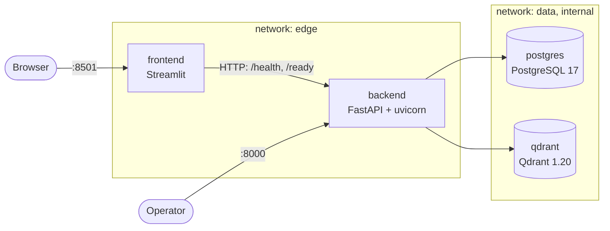

# HP Docs Chatbot

A chatbot that will answer questions about two public HP documents using
Retrieval-Augmented Generation (RAG):

- HP ENVY 6000 All-in-One series User Guide
- OMEN 17.3 inch Gaming Laptop PC Maintenance and Service Guide

> **Status: Phase 0 (foundation) complete.** The repository contains the running
> skeleton: API with health and readiness checks, a placeholder Streamlit page,
> Postgres, Qdrant, quality gates and CI. Ingestion, retrieval and chat are not
> built yet; see [Status](#status).

## Architecture



- **frontend** talks to the backend only over HTTP, from the Streamlit server.
- **backend** is the only service on both networks. `GET /health` is liveness and
  never touches dependencies; `GET /ready` probes Postgres (`SELECT 1`) and Qdrant
  (`/readyz`) concurrently and returns `503` with a per-dependency status document
  when one is down. Migrations (Alembic) run at container start.
- **postgres** and **qdrant** sit on an internal network with no route out and are
  never published.

Layering inside the backend: `api` → `services` → `domain` ← `infra`. `domain`
holds pure types and interfaces (for example `DependencyProbe`); `infra` holds the
real adapters; unit tests use fakes of the domain interfaces. The decisions behind
this are recorded in [docs/adr](docs/adr).

## Quick start

Requirements: Docker with Compose v2.

```bash
cp .env.example .env        # then set POSTGRES_PASSWORD in .env
docker compose up --build   # or: make up (waits until every service is healthy)
```

- Frontend: http://localhost:8501 (shows backend health and readiness)
- API: http://localhost:8000 (`/health`, `/ready`, `/docs`)

Compose refuses to start without `POSTGRES_PASSWORD`. Only the API and the frontend
are published, on `127.0.0.1` by default. On a remote VM set `BIND_ADDRESS=0.0.0.0`
in `.env` to reach them from outside, and restrict access with the VM's firewall.

## Configuration

Everything is configured through environment variables (`.env` for Compose).
Compose-only keys: `BIND_ADDRESS`, `API_PORT`, `FRONTEND_PORT`. The frontend reads
`BACKEND_URL` (default `http://backend:8000`). Backend settings:

<!-- settings-table:start (generated by `make docs-config`) -->
| Variable | Default | Description |
|---|---|---|
| `APP_ENV` | `development` | `development`, `test` or `production`. |
| `LOG_LEVEL` | `INFO` | `DEBUG`, `INFO`, `WARNING`, `ERROR` or `CRITICAL`. |
| `LOG_INCLUDE_EXCEPTION_MESSAGES` | `false` | Log exception messages (they may contain user text). Local debugging only; rejected in production. |
| `CORS_ALLOWED_ORIGINS` | `http://localhost:8501` | Comma-separated browser origins allowed by CORS; `*` is rejected. |
| `API_DOCS_ENABLED` | `true` | Serve `/docs`, `/redoc` and `/openapi.json`. |
| `POSTGRES_HOST` | `postgres` | Postgres host (fixed in Compose). |
| `POSTGRES_PORT` | `5432` | Postgres port (fixed in Compose). |
| `POSTGRES_DB` | `hpdocs` | Database name. |
| `POSTGRES_USER` | `hpdocs` | Database user. |
| `POSTGRES_PASSWORD` | *required* | Database password. Required; never has a default. |
| `POSTGRES_POOL_SIZE` | `5` | Pooled connections kept per API process. |
| `POSTGRES_MAX_OVERFLOW` | `5` | Extra connections beyond the pool; the cap is pool size plus this. |
| `POSTGRES_CONNECT_TIMEOUT_SECONDS` | `5.0` | Timeout for opening a Postgres connection. |
| `QDRANT_URL` | `http://qdrant:6333/` | Qdrant REST base URL (fixed in Compose). |
| `READINESS_TIMEOUT_SECONDS` | `2.0` | Per-dependency timeout for `GET /ready`. |
| `CORPUS_DIR` | `corpus` | Cache directory for the verified source PDFs; reused offline. |
| `CORPUS_MAX_BYTES` | `33554432` | Largest accepted source PDF, in bytes. |
| `CORPUS_DOWNLOAD_TIMEOUT_SECONDS` | `120.0` | Per-phase HTTP timeout and total deadline for one PDF download. |
| `EMBEDDING_DENSE_MODEL` | `BAAI/bge-small-en-v1.5` | fastembed dense model; its tokenizer also measures chunk size. |
| `EMBEDDING_SPARSE_MODEL` | `Qdrant/bm25` | fastembed sparse model. |
| `EMBEDDING_CACHE_DIR` | `models` | Cache directory for the downloaded embedding models; reused offline. |
| `EMBEDDING_BATCH_SIZE` | `32` | Texts per embedding batch (bounds memory). |
<!-- settings-table:end -->

A unit test fails if this table, `.env.example` and the `Settings` class disagree.

## Make targets

| Target | What it does |
|---|---|
| `make install` | Install the locked dependencies of both projects (used by CI) |
| `make setup` | `install` plus the pre-commit hooks (local development) |
| `make lint` / `make format` | ruff check and format, backend and frontend |
| `make typecheck` | mypy `--strict`, backend and frontend |
| `make test` | Unit tests with a branch-coverage gate of 90%, both projects |
| `make test-int` | Integration tests against real Postgres and Qdrant (Docker) |
| `make security` | bandit, pip-audit on both lock files, gitleaks on the history |
| `make images` / `scan-images` / `scan-config` | Build images; Trivy image and Dockerfile scans |
| `make lint-workflows` | actionlint on the GitHub Actions workflow |
| `make up` / `make down` | Start (waiting for health) or stop the stack |
| `make docs-config` | Print the configuration table above |
| `make check` | lint + typecheck + test + security; run before every commit |
| `make ingest` / `eval` / `load` | Later phases; print "not implemented yet" and fail |

## Repository layout

```
backend/            FastAPI app (uv project, own lock file)
  app/api/          routes and FastAPI dependencies
  app/core/         settings, JSON logging, request ID middleware, errors
  app/domain/       pure types and interfaces (no I/O)
  app/services/     orchestration (readiness)
  app/infra/        Postgres engine, ORM base, probes, HTTP client, lifecycle
  app/ingestion/    empty until Phase 1
  alembic/          migrations (empty baseline revision 0001)
  tests/unit/       no network, no containers; coverage gate
  tests/integration/  real Postgres and Qdrant
frontend/           Streamlit app (uv project, own lock file)
eval/, loadtest/    placeholders for Phases 2, 5 and 6
docs/adr/           architecture decision records
docker-compose.yml       full stack
docker-compose.test.yml  throwaway Postgres and Qdrant for integration tests
```

## Development and testing

Requirements: Python 3.12, [uv](https://docs.astral.sh/uv/), Docker.

```bash
make setup
make check       # what CI runs on every push, minus integration and images
make test-int    # starts docker-compose.test.yml on 127.0.0.1:55432/56333, tears down
```

The project is built test-first. Unit tests use fakes that implement the domain
interfaces (for example `FakeProbe`), never real databases or the network; the
backend and the frontend each have a 90% branch-coverage gate (currently 100%).
Integration tests run Alembic and the probes against real containers and fail,
rather than skip, when those containers are not running.

Run the pieces without Docker (needs the variables from `.env.example`):

```bash
cd backend && uv run uvicorn app.main:create_app --factory --no-server-header
cd frontend && BACKEND_URL=http://localhost:8000 uv run streamlit run app.py
```

CI (GitHub Actions) runs lint, typecheck, unit tests with a coverage summary,
integration tests, security scans and a Docker build with Trivy. Every job calls
the Makefile, so CI and local runs execute the same commands.

## Security and data governance

- **Secrets** come only from environment variables. `.env` is git-ignored and
  `.env.example` holds placeholders. The database password is a `SecretStr`, the
  DSN is unwrapped in exactly one place, and neither appears in logs, images or
  `docker history`.
- **Logs** are one JSON object per line with a request ID. Request bodies and query
  strings are never logged; exception messages are left out of logs by default,
  because they can contain user text (`LOG_INCLUDE_EXCEPTION_MESSAGES` re-enables
  them locally and is rejected in production).
- **Errors** share one JSON shape and never include stack traces or internals;
  validation errors omit the submitted input.
- **Containers** run as non-root numeric users, with all capabilities dropped,
  `no-new-privileges` and a read-only root filesystem. Base images are pinned by
  digest and scanned with Trivy; dependencies are locked and audited with
  pip-audit; Dependabot proposes updates weekly.
- **Corpus**: the HP PDFs are copyrighted by HP and are not in this repository.
  From Phase 1, ingestion will download them from their public URLs and verify
  pinned checksums.
- **Third-party processing**: no LLM is called yet. From Phase 3, when the cloud
  provider (Anthropic) is enabled, user questions and the retrieved document
  excerpts will be sent to the Anthropic API to generate answers.

## Known limitations

- Unhandled server errors (500) carry no CORS headers, because the request ID
  middleware sits outside CORS. The frontend calls the API from its server, so it
  is unaffected.
- Migrations run when the backend container starts; with several replicas they
  will need a single migration job (Phase 6).
- The Postgres pool is sized per process and has no explicit `pool_timeout` yet
  (SQLAlchemy's 30 s default applies).
- The frontend image is about 830 MB, mostly Streamlit's own dependencies.
- The runtime images run `apt-get upgrade` to pick up two zlib security fixes that
  the pinned base image lacks; it goes away with the next base image bump.

The full list, with the reasoning, is in [ADR 0001](docs/adr/0001-architecture-overview.md).

## Status

| Phase | Scope | Status |
|---|---|---|
| 0 | Foundation: repo, tooling, CI, compose, health endpoints | done |
| 1 | Ingestion: download, parse, clean, chunk, embed, upsert, manifest | pending |
| 2 | Retrieval: hybrid search, reranker, golden set, retrieval metrics | pending |
| 3 | Chat API: LLM gateway, prompt, citations, streaming, history | pending |
| 4 | Frontend: Streamlit chat UI with conversations and sources | pending |
| 5 | Benchmark: generation metrics, ablation, report | pending |
| 6 | Load testing: Locust profiles, tuning, capacity report | pending |
| 7 | Hardening: security review, docs, demo script | pending |

## License

MIT, see [LICENSE](LICENSE).
