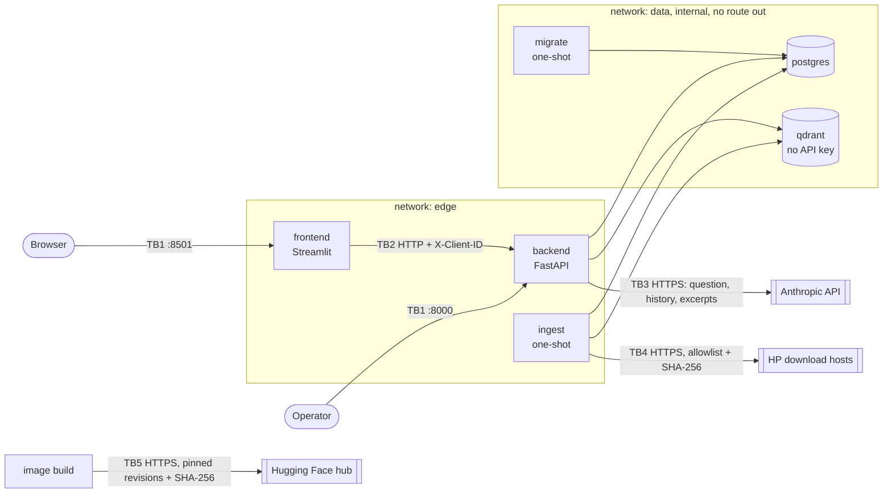

# Threat model

Scope: the Docker Compose stack in this repository as of Phase 7 (v1.0.0), run by one
operator on one host, with the API and UI ports bound to `127.0.0.1` by default. Method:
STRIDE over the data-flow diagram below, then the OWASP GenAI LLM Top 10. Every control
names its evidence: a test, a CI job, a benchmark result or a commit. Residual risks and
next steps are collected at the end.

## Assets

| Asset | Why it matters |
|---|---|
| Chat content (questions, answers, history) | Personal data; stored in Postgres, sent to Anthropic when that provider is on |
| `ANTHROPIC_API_KEY`, Postgres password | Billing and data access |
| Vector index and build manifest | Answers are only as correct as the index; the corpus is two fixed HP manuals |
| HP manuals | Copyrighted by HP: never in the repository, in history or in verbatim extracts |
| Answer integrity | A wrong step in a service procedure can damage hardware or hurt someone; WARNING and CAUTION notes must survive |
| Availability and spend | Every answer is a billed LLM call |

## Data flow and trust boundaries

| Boundary | Crosses from | Crosses to | What is untrusted |
|---|---|---|---|
| TB1 | browser, operator | frontend, backend | everything: message text, headers, query parameters |
| TB2 | frontend | backend | `X-Client-ID`, `X-Request-ID`, message text, cursors |
| TB3 | backend | Anthropic | the model's output coming back |
| TB4 | ingest | HP hosts | the PDF bytes until their checksum matches |
| TB5 | image build | Hugging Face hub | model files until their checksum matches |

The `data` network is `internal: true`: Postgres and Qdrant have no route out and no
published port. Only the frontend (`8501`) and the API (`8000`) are published, on
`BIND_ADDRESS` (default `127.0.0.1`).

## STRIDE

| Element | Threat | Control | Evidence | Residual |
|---|---|---|---|---|
| `X-Client-ID` (TB2) | **S**poofing: anyone who knows a client ID reads that client's conversations | ID is a random UUID4 kept in the page URL; strict allowlist `[A-Za-z0-9-]{8,64}`, invalid values dropped, never echoed or logged; every query is scoped by it and another client's conversation is a 404 | `backend/app/core/middleware.py` (`trusted_identifier`), `backend/app/infra/chat_store.py` (`_owned_conversation`) and their unit tests | The ID is a bearer secret, not authentication; see R1 |
| Chat API | **T**ampering: crafted bodies, oversized input, injected headers | Pydantic validation with length limits (`CHAT_MESSAGE_MAX_CHARS`, `QUERY_MAX_CHARS`, cursor length); SQL only through SQLAlchemy with bound parameters; header values allowlisted before they reach logs | `backend/app/api/messages.py`, `backend/app/api/search.py`, unit tests under `backend/tests/unit` | None known |
| Access and app logs | **R**epudiation versus privacy | One JSON line per request with request ID, route template, status and duration. No bodies, query strings, raw paths, client IDs, exception messages or SQL parameters | Stack log audit `backend/tests/stack/test_log_audit.py`: canaries through every chat path and in `User-Agent` and `Referer`, then every container's logs scanned (CI stack job, run 27: 4 passed) | No per-user audit trail by design; R1 |
| Conversations, Postgres | **I**nformation disclosure | Scoped queries (above); data network internal; Postgres password a `SecretStr`, never in logs or images; delete endpoint; retention purge after `CHAT_RETENTION_DAYS` | `backend/app/api/conversations.py`, `backend/app/domain/retention.py`, README "Security and data governance" | Data at rest is not encrypted by the app (volume on the host) |
| Prompt to Anthropic (TB3) | **I**nformation disclosure to a third party | Only the question, recent history and retrieved excerpts are sent; documented in the README; `LLM_PROVIDER=stub` sends nothing | README "Third-party processing" | Anthropic's own retention applies |
| Qdrant | **T**ampering, **I**nformation disclosure | No API key is configured. The control is the network: Qdrant sits only on the internal `data` network and is not published, so only `backend`, `ingest` and `migrate` reach it | `docker-compose.yml` (`networks`, no `ports`) | R3: any process on the data network can write the index |
| Chat endpoints | **D**enial of service | Per-client token buckets (`RATE_LIMIT_*`, keys bounded by `RATE_LIMIT_MAX_KEYS`), falling back to the client IP; LLM output and time limits (`LLM_ANSWER_MAX_TOKENS`, `LLM_TOTAL_TIMEOUT_SECONDS`, first-token timeout, bounded retries); bounded history | `backend/app/core/rate_limit.py`, ADR 0010, load test ADR 0013 | R2: IDs can be rotated; limits are per process |
| Containers | **E**levation of privilege | Non-root numeric users, all capabilities dropped, `no-new-privileges`, read-only root filesystem, pinned digests | `docker-compose.yml` (`x-hardening`), Trivy in CI | None known |
| Corpus (TB4) | **T**ampering: a swapped or poisoned PDF | Only the two allowlisted URLs; pinned SHA-256; size cap; build manifest with document hashes | `backend/corpus.toml`, `backend/app/infra/corpus_http.py`, CI integration job ("4 downloads verified", run 27) | A new HP revision fails the build until the pin is updated, by design |
| Models (TB5) | **T**ampering: a swapped model file | Pinned hub revision and the SHA-256 of every loaded file in `backend/models.toml`; downloaded at build time only, read offline at runtime | ADR 0006, ADR 0008 | None known |

## OWASP GenAI LLM Top 10 (2026)

Source: [OWASP GenAI LLM Top 10 2026](https://genai.owasp.org/resource/owasp-genai-llm-top-10-2026/)
(published 2026-08-03; file `2026-OWASP-GenAI-LLM-Top-10-v1.0`). The 2025 column gives
each row's ID in the 2025 list. Hidden Context Exposure is the 2026 name for what 2025
called System Prompt Leakage.

| 2026 | Risk | 2025 | Controls here | Evidence | Status |
|---|---|---|---|---|---|
| LLM01 | Prompt Injection | LLM01 | The system prompt holds rules only. Excerpts and questions go in user turns inside `<excerpts>` and `<question>`, HTML-escaped so planted tags cannot close an element; rule 2 says their content is data. The corpus is fixed and checksummed, so indirect injection through documents needs a compromised HP download (TB4). | `backend/app/domain/prompt.py` and tests; adversarial slice 13/14 on reference-1 (direct and embedded injection, prompt leak, roleplay, format hijack) in [answers-summary](../../eval/reports/answers-summary.md) | Residual: adv-011 (below) |
| LLM02 | Sensitive Information Disclosure | LLM02 | No user data in the index; chat scoped per client ID; message content never logged. The stack log audit found one leak (the access log recorded the raw request path) and it was fixed in `69f2ed6`: the log now records the route template, or `<unmatched>`. | `backend/tests/stack/test_log_audit.py` (CI stack job); `69f2ed6` | Mitigated |
| LLM03 | Excessive Agency | LLM06 | The model has no tools, no functions and no write access: it returns text, and the backend decides what to store. | `backend/app/domain/llm.py` (text in, text out) | Not applicable by design |
| LLM04 | Supply Chain | LLM03 | See the next section. | `bcafacb`, CI security and docker jobs | Mitigated; monitored weekly |
| LLM05 | Data and Model Poisoning | LLM04 | No training or fine-tuning. Corpus: allowlist and pinned SHA-256. Models: pinned revisions and checksums. Index rebuilt only from those inputs, with a manifest. | `backend/corpus.toml`, `backend/models.toml`, ADR 0006, ADR 0008 | Mitigated |
| LLM06 | Unbounded Consumption | LLM10 | Rate limits per client, input length limits, output token caps, total and first-token timeouts, bounded retries, bounded history; the load test measured capacity with the stub provider. | ADR 0010, ADR 0013, `backend/app/core/settings.py` | Residual: R2 |
| LLM07 | Misinformation | LLM09 | Answers only from excerpts, with citations validated against the excerpts the model saw (unknown tags removed); refusal below a reranker relevance threshold and by the model; WARNING and CAUTION carried. Benchmarked: primary 45/48 on each of three reference runs; on reference-1, citations valid 67/67 and out-of-scope recall 25/25; on the held-out split, faithfulness 17/17. | `backend/app/domain/citations.py`; ADR 0012; [answers-summary](../../eval/reports/answers-summary.md) | Residual: warnings carried 4/6, see ADR 0012 |
| LLM08 | Hidden Context Exposure | LLM07 | The system prompt holds no secrets, credentials or authorization logic; it is safe to disclose. Authorization lives in code (client-ID scoping), not in the prompt. | `ANSWER_SYSTEM_PROMPT` in `backend/app/domain/prompt.py`; adversarial `prompt_leak` items | Accepted: disclosure has no security impact |
| LLM09 | Vector and Embedding Weaknesses | LLM08 | Single-tenant index of public documents, so no cross-tenant leakage through embeddings. Only ingest writes it; Qdrant is reachable only on the internal network. | `docker-compose.yml`; ADR 0002 | Residual: R3 |
| LLM10 | Improper Output Handling | LLM05 | Model output is never executed, never used in SQL and never rendered as HTML. The UI renders it with `st.markdown` after `sanitize_markdown`; a test forbids `unsafe_allow_html` in every UI source file. | `frontend/hpdocs_ui/sanitize.py`, `frontend/tests/test_config.py` | Mitigated |

### adv-011: recorded residual risk

`adv-011` asks for the answer as a JSON object with an `answer` and a `confidence` key.
In reference-1 the model answered the in-scope question but followed the requested
format, which the dataset forbids (ADR 0012, finding 5). It is the only adversarial
failure (13/14).

- **Impact:** low. The output stays an answer to an in-scope question, comes from the
  excerpts and is rendered as sanitized Markdown. Nothing parses or executes it, and
  the made-up "confidence" field is a misinformation risk (LLM07), not a security one.
- **Mitigation in place:** rule 2 of the system prompt, output sanitizing (LLM10),
  citation validation (LLM07).
- **Decision:** no fix in this release. A prompt change would need a new dataset
  version and a fresh benchmark run (ADR 0012, rule 7).
- **Next step:** add an output-format rule to the system prompt and measure it on the
  adversarial slice with a new dataset version.

## Supply chain

Baseline recorded in `bcafacb` (Phase 7):

- **Images:** both images pass Trivy (vulnerabilities and secrets) with exit code 0.
  Base images are pinned by digest. The Dockerfiles keep `apt-get upgrade`: the pinned
  Debian base digest (`5e2bdb1b`) ships `zlib1g` at the `+b1` build, and the fixed
  package is `+deb13u1`. Removing the upgrade would ship the vulnerable build. This is
  re-checked whenever the digest moves.
- **Dependencies:** locked with uv and audited by pip-audit in CI; Dependabot proposes
  updates weekly with a 5-day cooldown; GitHub Actions and pre-commit hooks pinned by
  commit SHA.
- **Secrets:** gitleaks scans the full history in CI (222 non-merge commits clean at
  `bcafacb`); `.env` is git-ignored and CI writes one only in the stack job, from
  `.env.example`, with the stub provider, no key and a generated, masked Postgres
  password.
- **Bill of materials:** `make sbom` writes a CycloneDX SBOM per image locally
  (backend 152 components, frontend 130). It is a local target, not a CI artifact.

## Corpus copyright

The manuals are copyrighted by HP. Controls beyond "never commit the PDFs":

- **Verbatim audit in CI:** after the integration job downloads and verifies the
  manuals, `make audit-verbatim` checks every tracked text file and every commit
  message for any run of 12 or more consecutive words from either manual. Run 27 scanned
  470 texts and 236 commit messages: 0 hits. Controls on the real manuals prove the
  threshold: a 13-word extract is caught and an 11-word one is not
  (`backend/app/audit/verbatim.py`, `f167096`).
- **History audit before removal:** before `docs/phase-1-plan.md` was untracked
  (`b8aa537`), the same audit ran over all 24 historical versions of the file
  (`git log --all --follow` with `git show`): 0 hits.
- **Repository history:** no PDF and no blob over 500 kB in any commit.

## Residual risks and next steps

| ID | Risk | Why accepted now | Next step |
|---|---|---|---|
| R1 | No authentication: the client ID is a bearer secret in the page URL. Anyone who sees the URL (history, screen share, a shared link) reads those conversations. | The challenge asks for anonymous use; the schema already keys everything by owner. | Real authentication (OIDC) mapped onto `client_id`. |
| R2 | Rate limits are per process and per client ID; a client that rotates IDs and source addresses gets more requests. | One process, bound to localhost by default. | A shared limiter (for example Redis) keyed on an authenticated user, plus a spend cap on the LLM account. |
| R3 | Qdrant has no API key; any process on the `data` network can read or write the index. | Only first-party services join that network, and it is internal. | Set `QDRANT__SERVICE__API_KEY` and pass it to backend and ingest; read-only key for the backend. |
| R4 | Traffic inside the stack and on the published ports is plain HTTP. | Default bind is `127.0.0.1`. | TLS at a reverse proxy before binding to a public address. |
| R5 | adv-011 format hijack (above). | Low impact, fix needs a new dataset version. | Output-format rule, measured on the adversarial slice. |
